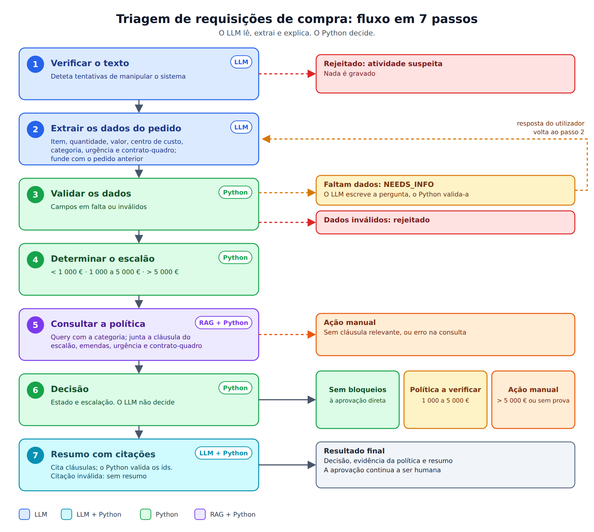

# Triagem de requisições de compra

Assistente de triagem para pedidos de compra (Purchasing / P2P). O utilizador descreve o pedido em texto livre; a aplicação extrai os dados, valida-os, determina o escalão de valor e consulta a política de compras. Devolve uma de três saídas: sem bloqueios, política a verificar, ou ação manual.

O LLM nunca aprova nada: só lê e extrai. As decisões são código Python determinístico, e a aprovação continua a ser humana.

Projeto final do curso "Generative AI: Fundamentos e Aplicação" (EDIT).

## Problema e utilizador

Pedidos de compra chegam incompletos ou mal descritos, e quem os trata tem de conferir à mão regras de cotações e escalões espalhadas por vários documentos.

- **Utilizador:** quem faz o pedido, em texto livre.
- **Destinatário:** a equipa de Compras, que recebe pedidos triados e com a evidência da política à vista.

## Fluxo



1. **Verificar o texto** (LLM): deteta tentativas de manipular o sistema. Texto suspeito, ou falha neste passo, rejeita o pedido.
2. **Extrair os dados** (LLM): item, quantidade, valor estimado e centro de custo, com saída validada por schema (Pydantic).
3. **Validar** (Python): dados em falta dão `NEEDS_INFO`; dados inválidos dão `REJECTED`.
4. **Determinar o escalão** (Python): abaixo de 1 000 €, de 1 000 a 5 000 € (inclusive) ou acima de 5 000 €.
5. **Consultar a política** (RAG): pesquisa por similaridade sobre as cláusulas da política; mostra a cláusula, o documento e o score.
6. **Decisão** (Python): sem bloqueios, política a verificar, ou ação manual.

## Comportamento quando falta informação ou há risco

| Situação | Resultado |
|---|---|
| Faltam dados | `NEEDS_INFO`. O utilizador responde na mesma caixa e a resposta é fundida com o pedido anterior (o dado novo prevalece). Só pedidos em `NEEDS_INFO` aceitam respostas de seguimento. |
| Dados inválidos | `REJECTED` (`INVALID_DATA`) |
| Texto suspeito, ou falha do screening | `REJECTED` (`SUSPICIOUS_ACTIVITY`) |
| Valor acima de 5 000 € | Ação manual (`OVER_THRESHOLD`) |
| Nenhuma cláusula relevante na política | Ação manual (`NO_POLICY_EVIDENCE`) |
| Erro na consulta da política | Ação manual (`RETRIEVAL_ERROR`) |

O sistema nunca assume que "não há regra": sem evidência, escala para uma pessoa.

## Política de compras (RAG)

`data/policies/` contém um corpus fictício de 8 documentos e 47 cláusulas, com emendas (`08`) que alteram cláusulas anteriores e lacunas intencionais (por exemplo, licenças de software ou leasing), para testar a abstenção.

- **Chunking:** uma cláusula por chunk, com o prefixo `Documento | Cláusula | Título` no texto e metadados (`source`, `clause`, `title`, `effective_date`, `chunk_id`).
- **Embeddings:** `text-embedding-3-small`, guardados em Chroma (distância cosseno).
- **Query:** só o item (`Compra de <item>`). O escalão não entra na query: é determinado em Python e a cláusula correspondente (2.1, 2.2 ou 2.3) é juntada por id.
- **Seleção:** `min_score = 0.52` e no máximo 6 cláusulas. Limiar **provisório**, escolhido a partir dos scores observados (itens com cobertura ≥ 0.57, sem cobertura ≤ 0.47); será recalibrado com o eval.

## Estrutura

```
app/streamlit_app.py       interface (passos a atualizar em tempo real)
data/policies/             corpus de políticas (markdown)
scripts/build_index.py     cria o índice Chroma
src/pr_triage/
  domain/                  schemas, estados, escalões, validação, merge
  llm/                     screening e extração (OpenAI Responses API)
  rag/                     chunking, índice, pesquisa, seleção de contexto
  storage/db.py            SQLite
  workflow.py              fluxo por passos (emite um evento por passo)
  service.py               fluxo + persistência
```

## Como correr

```bash
uv sync
cp .env.example .env        # preencher OPENAI_API_KEY
uv run python scripts/build_index.py
uv run streamlit run app/streamlit_app.py
```

Cada pedido (exceto os suspeitos) fica registado em `pr_triage.db` (SQLite, ignorado pelo Git).

## Estado

**Já funciona:** fluxo completo com interface, persistência, RAG com evidência visível, escalamento a ação manual.

**Por fazer:**

- Resposta fundamentada com citações validadas.
- Conjunto de ~30 casos de teste etiquetados (desenvolvimento e holdout) para medir o fluxo e calibrar o limiar.
- Contador de tentativas suspeitas por sessão.
- Pergunta de seguimento redigida por LLM (hoje a mensagem é fixa).